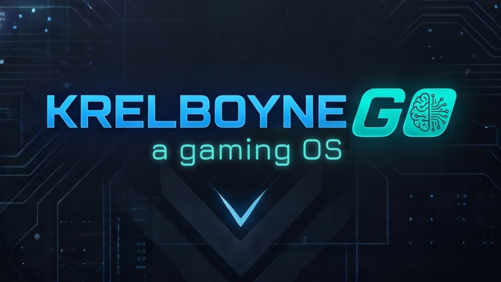

  

# Krelboyne Go (KrelGo)

A gaming OS for the original Lenovo Legion Go, built on Debian 13 (trixie) with live-build. It boots to a dark teal Xfce desktop in landscape at 144 Hz, with Steam, Proton, RetroArch and ES-DE ready to play.

Website: [krelboyneos.org/krelgo.html](https://krelboyneos.org/krelgo.html)

**Status: 0.1.1 alpha.** It runs installed on a Legion Go: Steam games through Proton, ES-DE and RetroArch, and the built-in controller in all of them.

Sister project of [KrelboyneOS](https://github.com/grumpy-gaming/KrelboyneOS), which this repo's layout is copied from.

## What's in it

- Steam (Proton comes with Steam Play)
- RetroArch with a starter set of cores, and ES-DE as the game frontend
- Firefox ESR and the Onboard on-screen keyboard, also on the login and lock screen
- PipeWire sound, Wi-Fi and firmware, clock set from the internet
- Made for the Go: landscape at 144 Hz on the login screen and desktop, 160 DPI text, tap-to-click

Anything else is opt-in and untested, at your own risk.

## Tested on the Legion Go

Works: live boot, install to the internal SSD, landscape at 144 Hz, AMD graphics, Wi-Fi, sound, touchpad, touchscreen, the controller in Steam, ES-DE and RetroArch, Steam games through Proton.

Not tested yet: sleep and resume, the volume and brightness buttons, rumble, the rear paddles and the gyro ([#4](https://github.com/grumpy-gaming/krelgo/issues/4)).

## Known issues (0.1.1)

- The boot menu appears sideways, because the Go's screen is portrait until Linux starts ([#1](https://github.com/grumpy-gaming/krelgo/issues/1)).
- Secure Boot must be off on the Go to boot from a USB stick or microSD card.

## Download

- [krelboynego-amd64.hybrid.iso](https://dl.krelboyneos.org/krelboynego-amd64.hybrid.iso) (about 2.1 GB)
- [krelboynego-amd64.hybrid.iso.sha256](https://dl.krelboyneos.org/krelboynego-amd64.hybrid.iso.sha256)

Download both into the same folder and check the ISO:

    sha256sum -c krelboynego-amd64.hybrid.iso.sha256

## Install it on the Go

1. Turn Secure Boot off in the Go's BIOS. With it on, the Go doesn't show its USB or card port as a boot device.
2. Put the ISO on a USB stick or microSD card (Ventoy, balenaEtcher or `dd`) and boot it.
3. Try it live, then double-click **Install Krelboyne Go**. On the partitioning page, check the internal SSD is selected, not the USB stick or card. Erase disk replaces Windows, so back up first.

## Build it

On a Debian 13 machine with live-build:

    sudo lb clean; lb config; sudo lb build

The ISO, `krelboynego-amd64.hybrid.iso`, appears in the project folder.

## Layout

- `config/includes.chroot/etc/krelgo/branding.conf`: name, version and links, in one place
- `auto/config`: the main live-build settings
- `config/package-lists/`: packages in the image
- `config/hooks/live/`: build scripts (Steam, ES-DE, RetroArch, branding)
- `config/includes.chroot/`: files copied into the image as they are
- `artwork/`: original artwork. The 2560x1600 wallpaper is this image scaled to 1600 high, trimmed on the left, with the tagline redrawn larger in Jura SemiBold (Debian package `fonts-jura`)

## Help and support

- Help, bug reports and known issues: the [Discord](https://discord.gg/hzUZDPwBs7)
- Email: krelboyneos@gmail.com
- Like the project? [Ko-fi](https://ko-fi.com/krelboyneos)

## License

Krelboyne Go's own code (the build configuration, hooks, scripts and original artwork) is free software under the [GNU General Public License v3.0 or later](LICENSE). You can use, change and share it; if you share a changed version, it has to stay open under the same license. Steam, RetroArch, ES-DE and everything else in the image keep their own licenses.

The Krelboyne Go name and logo identify this project. Forks are welcome, but please give yours its own name.

Krelboyne Go is made by [grumpy-gaming](https://github.com/grumpy-gaming). It is an independent project, not affiliated with Debian, Lenovo or Valve.
